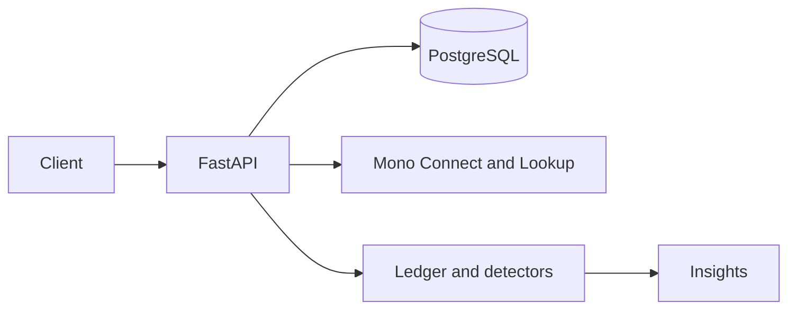
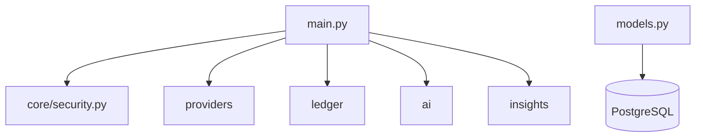

# Architecture

The backend is a FastAPI application using SQLAlchemy async sessions, PostgreSQL configuration, provider adapters, a consent-filtered ledger, deterministic insight detectors, and an optional aggregate-only AI layer. Main sources are `backend/app/main.py`, `models.py`, `providers/`, `ledger/`, `insights/`, and `ai/`.

The current sync path validates active consent, fetches provider transactions, deduplicates rows, normalises narration, rebuilds recurring series, and reruns insights. The first sync uses a 190-day window; later syncs overlap the last successful sync by three days. Mono account connection is webhook-first: processing does not fetch data, and account updates gate sync on `retrieved_data`.

Design decisions present in code include integer minor-unit amounts, UUID identifiers, consent ownership filters, hash-only BVN storage, encrypted provider account IDs/discovered account numbers, and provider adapters. Manual assets store the USD/NGN rate used at write time as parts per million. Scheduler, push delivery, durable unlink, and complete wipe are not implemented.
