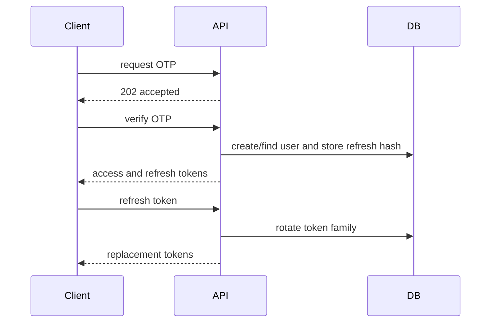

# Authentication

Authentication uses an email or E.164 phone OTP followed by application-issued JWT and refresh tokens. It does not use Firebase Auth. Last verified against `backend/app/main.py`, `backend/app/identity/otp.py`, and `backend/app/core/security.py`.

`POST /auth/otp/request` generates a random six-digit code, stores only a salted HMAC digest, and delivers it through a configured generic HTTP sender or the explicitly enabled local development inbox. It returns `202`. Codes expire in five minutes, are single-use, and invalidate after five failed attempts. There is a resend cooldown plus process-local per-identifier and per-IP throttling. `POST /auth/otp/verify` creates a user on first success and returns a 15-minute access JWT plus a 30-day refresh token. Refresh values are stored as hashes; rotation is single-use and replay revokes the token family.

`POST /auth/logout` revokes only the signed-in user's submitted refresh-token family; existing access JWTs remain valid until expiry. `POST /auth/logout-all` revokes all refresh tokens and rejects access tokens issued before logout-all. The HTTP OTP sender is vendor-neutral; delivery is not verified against a live vendor. Throttling remains process-local and is not safe across multiple workers. The [protected presenter inbox](demo-mode.md) supports allowlisted demo identities on the hosted backend, requires one worker, and is forbidden in production. Codes disappear on expiry, successful verification or attempt exhaustion.

