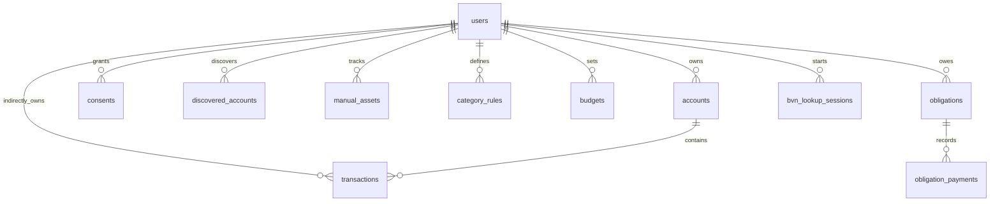

# Data model

This reference is generated from SQLAlchemy metadata. Run `python backend/scripts/gen_data_model.py` to regenerate [the table listing](api/data-model-generated.md). Migrations are under `backend/alembic/versions/`.

Sensitive fields include `users.bvn_hash` (hashed), `refresh_tokens.token_hash` (hashed), `device_tokens.token_hash` (dedupe hash), and encrypted discovered account/device fields. The generated document is authoritative for current columns.

| Revision | Description |
|---|---|
| 0001 | Initial schema. |
| 0002 | Provider links, webhook events, assistant conversations. |
| 0003 | AI metadata and audit. |
| 0004–0006 | Fetch account, asset, rule, budget, and notification foundation. |
| 0007 | Lookup sessions and encrypted discovered-account/device fields. |
| 0008 | OTP challenges and session revocation. |
| 0009 | Encrypted provider account identifiers. |
| 0010 | Discovered-account Link metadata. |
| 0011 | Obligations and linked payments. |
| 0012 | Webhook processing states, timestamps and claim token; no raw payload storage. |
| 0013–0022 | Statement, classification, insights, money views and reports. |
| 0023 | Notification delivery log, device validity and scheduler job-run locks. |

Revision 0009 now emits guarded offline schema SQL, but populated identifier encryption/decryption still requires its online Python migration and configured key. The initial revision uses current model metadata and several older revisions skip offline operations; SQL generation is not proof of a complete executable PostgreSQL migration history. Review and verify on disposable storage before changing Neon.
