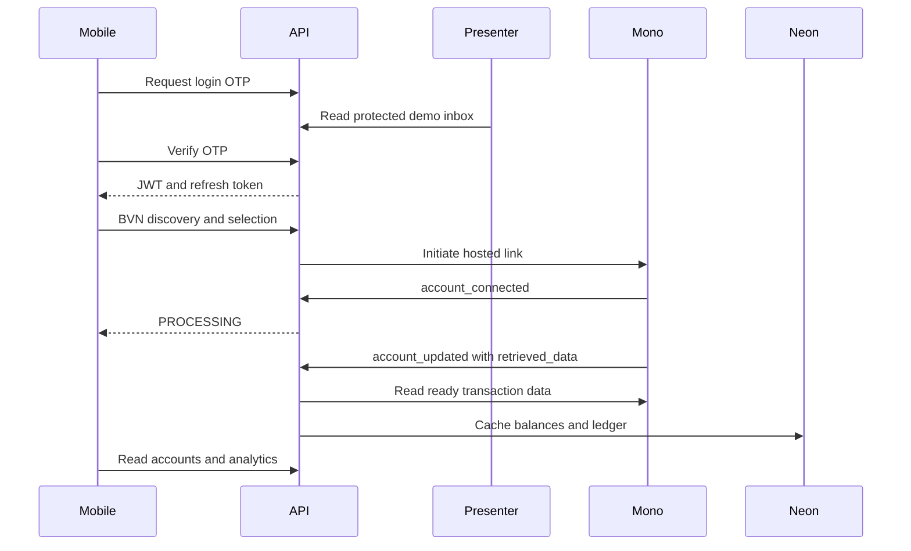

# Backend demo walkthrough

This guide prepares and demonstrates the existing mobile API with Mono sandbox and Neon. Last verified against `backend/app/main.py`, `backend/app/api_models.py`, and the mocked HTTP walkthrough in `backend/tests/test_demo_journey.py`. It does not verify live service availability or change the mobile app.

## Configure the hosted backend

Use your existing Neon connection URL in `DATABASE_URL`; the settings layer converts PostgreSQL URLs for asyncpg and translates `sslmode` to `ssl`. Configure stable `JWT_SECRET`, `OTP_SECRET`, `BVN_PEPPER`, and `FIELD_ENCRYPTION_KEY` through deployment secrets. Persistent encrypted data cannot survive a restart if the process-random development fallback is used.

Set `AGGREGATOR_PROVIDER=mono`, separate `MONO_SECRET_KEY` and `MONO_LOOKUP_SECRET_KEY`, `MONO_REDIRECT_URL` to the app's existing callback, and `PUBLIC_BASE_URL` to the hosted HTTPS API. Set `WEBHOOK_SECURE_KEY` to the secret configured for that backend URL in Mono. These settings do not create or configure a database server.

Enable the [presenter inbox](demo-mode.md) with `DEMO_MODE=true`, `OTP_SENDER=dev_inbox`, `OTP_DEV_INBOX_ENABLED=true`, `DEMO_IDENTIFIERS=user@example.com`, and a secret `DEMO_OTP_INBOX_PASSWORD`. Configure `ACCOUNT_REFRESH_COOLDOWN_SECONDS=300` for the sandbox demo and run one web worker. Mono requires at least five minutes per account for real-time requests. Use fictional allowlisted identities only. Enable Swagger for the non-production demo as needed.

## Demonstration sequence

Import the [Postman collection](api/postman/README.md) or open Swagger. The following order uses the existing API; bank authorisation happens on Mono's hosted page.

| Step | Backend request | Expected result |
|---|---|---|
| 1 | `GET /health` | Process liveness only; not a Neon or Mono readiness check. |
| 2 | `POST /auth/otp/request` with the allowlisted email | 202 sent. Open the presenter page, choose that email, and read the code. |
| 3 | `POST /auth/otp/verify` with email and generated OTP | Access and refresh tokens; code disappears from the inbox. |
| 4 | `POST /onboarding/bvn/start` with authorised sandbox test input | Session ID and OTP method hints. Do not use real BVNs. |
| 5 | `POST /onboarding/bvn/send-otp` | OTP delivery requested through Mono; the presenter inbox only shows app login codes. |
| 6 | `POST /onboarding/bvn/confirm` | Discovered rows with IDs and last-four digits; no balances. |
| 7 | `POST /accounts/discovered/select` with chosen row IDs | Unticked rows become skipped. |
| 8 | `POST /accounts/discovered/{row_id}/link` | Hosted `mono_url` and `ref`. Use the app's existing hosted authorisation flow. |
| 9 | `GET /accounts/link/status?ref=...` | PROCESSING after account_connected; AVAILABLE/PARTIAL and account_id after usable data arrives. This poll does not call Mono. |
| 10 | `GET /accounts`, `GET /transactions`, `GET /analytics/spending` | Cached balances grouped by category/currency, decoded activity, and spending totals. |
| 11 | `PATCH /transactions/{transaction_id}/category` | Optionally apply a category to existing and future matching transactions. |
| 12 | `GET /budget/velocity`, `GET /assets`, `GET /net-position`, `GET /obligations` | Supplementary finance records and valuations. |
| 13 | `POST /accounts/{account_id}/refresh` | synced, requested, or delayed with cached data; wait for Retry-After on 429. |
| 14 | `POST /auth/refresh`, then `POST /auth/logout` using the replacement refresh token | Rotation and family revocation. logout-all also invalidates earlier access tokens. |



## Prepare supplementary fictional records

After the allowlisted user has logged in, an operator may run the following against the intended demo database. This command writes only missing budgets, manual assets, and one manual obligation; it does not call Mono or change linked account data. It is not run by automated verification.

```powershell
cd backend
python -m scripts.demo_supplement --user-id <demo-user-uuid>
```

Get the user UUID through an authorised operator database query; it is not returned as a new login-response field. Defaults are a NGN 200,000 budget, NGN 50,000 asset, USD 100 asset, and NGN 10,000 Demo Loan due in three days. The USD fixture uses a fictional NGN 1,500/USD rate stored on that asset, not in the shared FX cache. Reruns preserve existing edits and do not reset due dates. Existing synthetic account/persona seeds are separate from sandbox-linked data.

## Operator checks not verified offline

- Confirm the intended Neon schema and Alembic revision using read-only operator queries. Do not downgrade or reset a populated Neon database for rehearsal.
- Before applying any migration, review it on a disposable branch/database using the persistent field-encryption key. Revision 0009 needs online Python encryption for populated provider links; its offline SQL refuses to discard unencrypted identifiers.
- The legacy initial migration derives schema from current models, and several historical revisions skip offline SQL. A successful offline command does not prove the full historical chain executes safely on PostgreSQL.
- Confirm both sandbox app keys, the existing app callback, and the backend webhook URL in the Mono dashboard. Use only the test details supplied for that account.
- Confirm webhook delivery reaches the backend with `mono-webhook-secret` and inspect processing metadata if an account stalls. A received 200 is not proof of successful sync.
- Confirm expected sandbox balances and activity before presentation. Test fixtures do not establish what your sandbox account will return.
- Check billing in your Mono dashboard. The current [Lookup guide](https://docs.mono.co/docs/lookup/bvn-igree) says requests, including failures, are billable; do not assume all sandbox products are free. Account matching remains off by default.

## Offline rehearsal

```powershell
cd backend
pip install -r requirements-docs.txt
python -m pytest -q tests/test_demo_journey.py
python -m pytest -q
python -m alembic heads
python -m alembic upgrade head --sql
python -m alembic downgrade head:base --sql
```

Tests use isolated SQLite storage and respx HTTP mocks. They never connect to Neon or Mono. Automatic push, reminders, retries, and full user wipe are [pending](KNOWN_GAPS.md).
